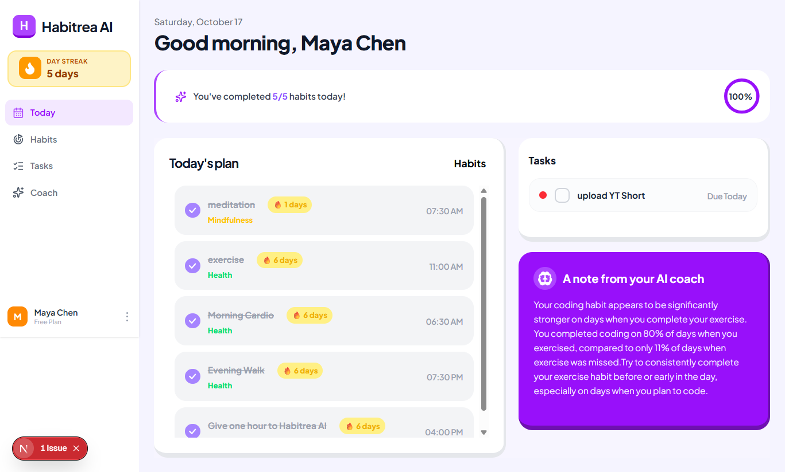
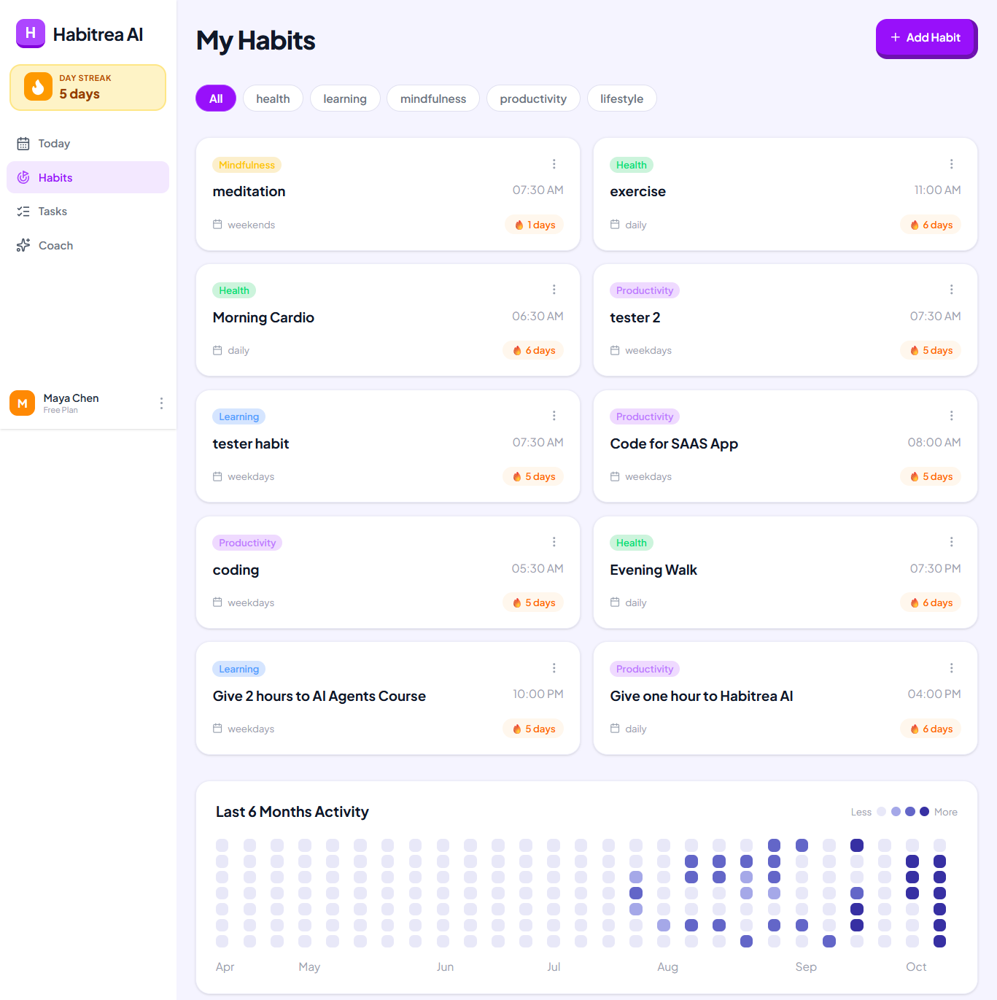
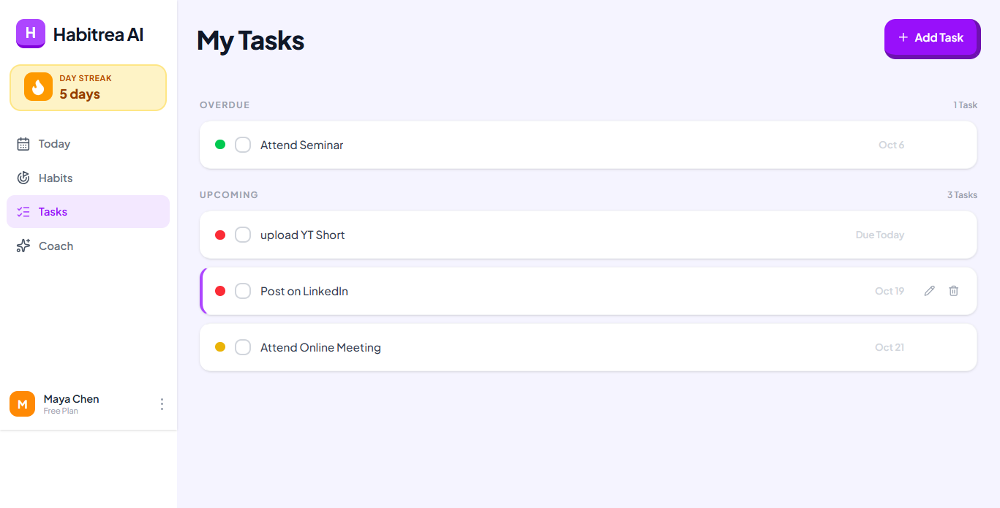

# Habitrea AI

Habitrea AI is a full-stack productivity app that combines habit tracking, task management, and AI-generated insights in one experience. Instead of only counting streaks, it analyzes your activity over time and generates weekly coaching based on your own completion patterns.





## Features
- **AI coaching.** Habit suggestions during onboarding and a short weekly insight based on your own data.
- **Instant-feeling UI.** Optimistic updates with rollback if the server disagrees.
- **Habits with real schedules.** Daily, weekdays, weekends each with a category and preferred time.
- **Streaks that are actually correct.** Computed from real completion history and each habit's schedule, with a GitHub-style heatmap of the last six months.
- **Tasks in three clear lists.** Overdue, upcoming, and completed, each paginated on its own.
- **Daily dashboard.** Today's plan, a circular progress indicator, and your latest AI insight in one view.

## Tech stack

- [Next.js](https://nextjs.org/) (App Router) and React
- [Supabase](https://supabase.com/) for authentication and data
- [Google Gemini](https://ai.google.dev/) for habit suggestions and coaching insights
- Tailwind CSS
- Shadcn UI

## Getting started

### Requirements

- Node.js 20.9 or later
- npm
- A Supabase project
- A Gemini API key for AI features

### Install and configure

1. Clone the repository and install dependencies:

   ```bash
   git clone https://github.com/Malaika-Ali/productivity-web-app-Nextjs.git
   npm install
   ```

2. Create `.env.local` in the project root:

   ```env
   NEXT_PUBLIC_SUPABASE_URL=
   NEXT_PUBLIC_SUPABASE_ANON_KEY=
   GEMINI_API_KEY=
   ```

   Get the Supabase URL and anon key from your project's API settings, and create a Gemini API key in Google AI Studio. Keep `.env.local` private and never commit real keys.

3. Set up Supabase authentication and the database tables used by the app: `profiles`, `habits`, `habit_completions`, `tasks`, and `ai_insights`. Configure row-level security so users can only access their own data. The repository does not currently include database migrations or a schema, so these need to be created in your Supabase project. Google sign-in is optional; enable the Google provider in Supabase if you want to use it.

4. Start the development server:

   ```bash
   npm run dev
   ```

   Open [http://localhost:3000](http://localhost:3000).

## Available scripts

| Command | Description |
| --- | --- |
| `npm run dev` | Start the local development server |
| `npm run build` | Create a production build |
| `npm run start` | Serve the production build |

## Roadmap
 
- Backfill `completed_at` on tasks for more precise time-of-day insights
- Category-level analytics over a full month, not just the current week
- Push notifications tied to each habit's preferred time

## About
 
Built by [Malaika](https://github.com/Malaika-Ali), a Computer Systems Engineering graduate who teaches web development and builds full-stack projects. If you want to talk about any of the decisions above, I'd like to hear from you.

## Contributing

Contributions are welcome. For a substantial change, open an issue first to discuss the approach. For a pull request, include a clear description of the change and run `npm run build` before submitting.
